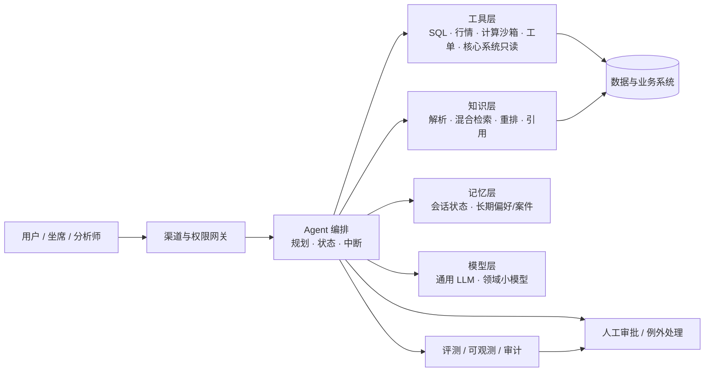

# 问题三：Prompt、Context、LangChain、RAG、Memory 等技术，哪些真正有用？

> 本文回答“具体哪些技术有用”。结论按**金融生产环境中的投入产出比**排序，而不是按技术热度。
> 引用编号对应 [`04-参考来源.md`](04-参考来源.md)。

## 0. 结论先行：技术优先级

| 优先级 | 技术 | 解决的核心问题 | 在金融场景中的定位 |
|---|---|---|---|
| ★★★★★ | **工具调用（Function Calling）** | 让模型能查、能算、能操作，而不是“凭记忆回答” | 正确性的地基；金额、日期、额度、行情、账户必须走工具 |
| ★★★★★ | **RAG（检索增强生成）** | 领域知识、时效性、可引用、可审计 | 研报、政策、合同、工单、产品文档的标配 |
| ★★★★☆ | **上下文工程（Context Engineering）** | 在有限窗口内放入“对的证据”，并控制成本 | 决定回答质量上限；比“雕花 Prompt”更值得投入 |
| ★★★★☆ | **评测、可观测、护栏** | 知道它什么时候会错、错了能否发现/拦截 | 生产准入条件，不是可选项 |
| ★★★☆☆ | **编排框架（LangGraph 等）** | 多步状态、审批中断、重试、审计 | 复杂工作流需要；简单问答不必上 |
| ★★★☆☆ | **Memory（记忆）** | 跨会话的偏好、历史、案件上下文 | 按需引入；用错会带来隐私与污染风险 |
| ★★☆☆☆ | **Prompt Engineering** | 指令、格式、角色、少样本示例 | 必要但已商品化，不是竞争壁垒 |
| ★★☆☆☆ | **微调 / 小模型** | 领域术语、成本、时延、私有化 | 特定条件下有价值，通常排在 RAG 之后 |
| ★☆☆☆☆ | **多 Agent 编排** | 任务分解、并行、权限隔离 | 少数场景适用；多数场景是过度设计 |

**一句话**：金融 Agent 的“硬地基”是 **RAG + 工具调用 + 上下文工程 + 评测治理**；LangChain/LangGraph 是脚手架，Memory 是可选件，Prompt 是必要但不够的“说明书”。

---

## 1. Prompt Engineering：必要，但不是护城河

**有用的部分**：
- **结构化指令**：明确角色、目标、边界、禁止事项、输出格式（JSON Schema）。
- **少样本示例**：给 2–5 个“输入→正确输出”的样例，比形容词更有效。
- **显式推理/行动范式**：ReAct 让模型交替产生“推理轨迹”和“工具动作”，从而能规划、追踪状态、处理异常。[17]
- **拒答与不确定性**：明确要求“证据不足时说不确定/转人工”，比要求“尽量回答”更重要。

**局限**：
- Prompt 不能弥补**缺数据、缺工具、缺权限**；也不能让模型可靠地做多位数心算。
- Prompt 对模型版本、上下文顺序、语言都敏感，必须版本化并纳入评测。
- 在金融场景，**“答案有出处”主要靠 RAG 和工具，不是靠一句“请引用来源”**。

**实践建议**：把 Prompt 当代码管理（版本、diff、回归测试）；把“格式约束”交给结构化输出/函数调用；把“知识”交给 RAG；把“计算”交给工具。

---

## 2. Context Engineering：比 Prompt 更值得投入

**核心事实**：上下文窗口不是“越大越好”。Liu 等人的研究发现，当相关信息位于长上下文中部时，模型性能显著下降；相关信息在开头或结尾时表现最好。[14] Anthropic 把这一现象及相关的“上下文腐化（context rot）”作为上下文工程的核心动机：上下文是有限资源，必须精心选择、压缩与组织。[9]

**真正有用的手段**：

| 手段 | 做法 | 金融场景示例 |
|---|---|---|
| 系统提示精简 | 只保留角色、边界、输出契约；把长政策放到检索层 | 不在 system prompt 里塞 50 页制度 |
| 即时检索（just-in-time） | 先判断需要什么，再按需取文档/字段，而不是一次性全量灌入 | 先取“授信政策第 4.2 条”，再取该客户财报 |
| 工具结果裁剪 | 工具只返回必要字段/摘要，避免整表整页 | 交易查询返回聚合与异常，不返回十万行流水 |
| 压缩/摘要 | 长对话或长文档分段总结，保留决策与证据 | 多轮尽调对话滚动摘要 |
| 结构化笔记 | 把关键事实、假设、待办写成结构化状态，跨步骤复用 | “案件档案”：客户、额度、缺失材料、风险点 |
| 子 Agent / 隔离上下文 | 把独立子任务放到独立上下文，返回摘要 | 反洗钱调查中并行查名单、网络、舆情 |

**金融落地要点**：
- 给每段上下文打**来源、时间、权限**标签；模型输出引用这些标签。
- 把“事实、假设、推断”分块；不要让模型在长文里自己猜哪句是事实。
- 对同一案件/客户做上下文隔离，避免跨用户信息泄漏。
- 记录 token 预算与成本；上下文工程同时是成本工程。

---

## 3. RAG：金融知识型 Agent 的默认架构

**为什么需要**：LLM 存在幻觉、知识过时、推理不可追溯等问题；RAG 通过引入外部知识库，提升准确性与可信度，并支持持续更新领域知识。[13] 对金融来说，RAG 还多了一层价值：**引用与审计**。

**一条可用的 RAG 流水线**：

```text
文档接入 → 解析（版式/表格/附件）→ 切分（按结构而非固定长度）
→ 索引（稠密 + 稀疏/BM25 + 元数据）→ 查询改写 → 混合检索
→ 重排（rerank）→ 证据组装 → 生成（带引用）→ 引用/数字校验
```

**从 Naive RAG 到 Advanced/Modular RAG**：RAG 综述把演进概括为 Naive RAG、Advanced RAG、Modular RAG，核心改进集中在检索前（查询改写、索引优化）、检索中（混合检索、重排）和检索后（压缩、校验）。[13]

**Agentic RAG**：让 Agent 自己决定“要不要检索、检索什么、证据够不够”，必要时改写问题再检索。LangGraph 的教程给出了一个典型模式：判断是否检索 → 检索 → 给文档打分 → 不满足则改写问题 → 再检索 → 生成。[12] 这比“每次固定 top-k”更适合复杂金融问题，但会增加时延与成本，需设上限。

**金融场景的六个特殊难点**：

1. **表格与附注**：财报、费率表、合同条款大量以表格/脚注存在，固定长度切分会破坏语义；需要表格感知解析、行级/单元格级引用。
2. **版本与时点**：监管规则、研报、财报都有版本和生效日；索引必须带 `as_of` 元数据，支持“当时有效”的检索。
3. **权限与多租户**：不同业务线/客户可访问的文档不同；检索前做权限过滤，不能靠模型“自觉不看”。
4. **数字与口径**：同一指标可能有多个口径（GAAP/非 GAAP、母公司/合并）；RAG 要返回口径说明，计算交给工具。
5. **时效性**：新闻、行情、公告需要增量索引与失效机制；过期文档要降权或标注。
6. **引用粒度**：引用到文档不够，最好到章节/段落/表格行；否则审计无法复核。

**评测 RAG 不能只看“答得像不像”**：
- 检索侧：Recall@k、MRR、权限过滤正确率；
- 生成侧：忠实度（faithfulness）、引用准确率、数字一致性、拒答正确率；
- 端到端：任务完成率、人工修改率、P95 时延与单次成本。

**常见坑**：只做向量检索不做重排；固定长度切分；不处理表格；索引不更新；把“检索不到”硬答成“没有”；忽略权限导致越权泄露。

---

## 4. 工具调用：金融 Agent 正确性的“地基”

**核心原则**：**LLM 负责理解、规划、解释；确定性工具负责计算、查询、执行。** 让模型心算复利、汇率换算、额度占用，是把系统性错误写进架构。

**金融场景常用工具**：

| 工具类型 | 用途 | 设计要点 |
|---|---|---|
| SQL / 数仓查询 | 客户、交易、持仓、额度 | 参数化、只读、行级权限、超时与行数上限 |
| Python 沙箱 | 财务计算、统计、回测 | 隔离、资源限额、依赖固定、禁止外网 |
| 行情/市场数据 | 价格、估值、风险指标 | 数据时点、供应商授权、缓存 |
| 文档解析 | PDF/Excel/扫描件 | 表格结构、页码、OCR 置信度 |
| 工单/流程系统 | 创建、分派、更新 | 幂等、白名单、人工确认 |
| 核心系统 | 账户、支付、授信 | 默认只读；写操作必须审批、限额、可回滚 |

**工程要点**：
- 工具 Schema 要**强类型、描述清晰、错误可读**；模型才能正确选参。
- 所有写操作具备**幂等键、超时、重试、补偿/回滚**；不要让 Agent 在失败后“猜着重试”。
- 工具返回结构化结果（含来源、时间、单位），而不是一段自然语言。
- 记录完整调用链：谁、何时、用何参数、返回什么、是否人审。
- 用 ReAct 式的“推理—行动—观察”循环时，设置最大步数与预算，防止死循环。[17]

OpenAI 的 Agent 构建指南把 Agent 定义为“模型 + 工具 + 指令”，并强调从单 Agent 开始、用工具与护栏控制风险，而不是一开始就堆多 Agent。[11]

---

## 5. Memory：按需引入，别把 RAG 当 Memory

**先分清两类记忆**：

- **短期记忆**：一次会话/任务内的消息与状态。LangGraph 用 thread-scoped checkpoint 持久化，可恢复、可回放。[12]
- **长期记忆**：跨会话的用户偏好、历史案件、组织知识。LangGraph 用 store 按 namespace 保存，可跨 thread 读取。[12]

**学术上的分类**：记忆机制综述从记忆的来源、形式与读写操作等维度进行梳理；实践中通常按“短期/长期”划分，长期记忆再分语义、情景、程序性记忆。关键设计问题是“存什么、怎么组织、何时读写、如何遗忘”。[15] MemGPT 则借鉴操作系统虚拟内存，把上下文分层管理，以突破窗口限制。[16]

**什么时候真的需要 Memory**：
- 多轮、跨天的案件处理（尽调、调查、理赔）；
- 投顾/客服需要记住客户偏好、风险等级、历史沟通；
- 长期运行的运营 Agent 需要记住“上次处理到哪一步”。

**什么时候不需要**：
- 静态制度/产品知识 → 用 RAG，不要写进记忆；
- 一次性问答 → 不需要长期记忆；
- 可以通过工具实时查询的事实 → 查工具，别缓存。

**风险与设计**：
- **隐私与隔离**：记忆按用户/租户/案件隔离，设置 TTL 与删除机制；满足数据最小化。
- **污染与过时**：写入前校验，允许人工修正；冲突时以最新/权威来源为准。
- **跨用户泄漏**：namespace 设计错误会把 A 客户偏好带给 B；必须做权限测试。
- **成本**：记忆检索也是检索，需控制召回数量与注入位置。

---

## 6. LangChain / LangGraph：脚手架，不是架构本身

**它们提供什么**：
- LangChain 提供模型、工具、检索器、消息等集成与抽象；
- LangGraph 提供**图结构编排**：state、node、edge、条件边；checkpoint 持久化、中断（interrupt）实现人工审批、time travel 回放、streaming、subgraph。[12]
- 配套 LangSmith 做 tracing/评测（商业化服务）。

**适合用的场景**：
- 多步工作流，需要在步骤间保存状态、失败重试、人工中断；
- 需要把“检索—工具—生成—校验”显式画成图，便于审计与调试；
- 团队需要统一的开发范式与可观测性。

**不适合/需要谨慎的场景**：
- 简单“一问一答 + 一次检索”：直接调模型 SDK 更轻；
- 团队没有评测/运维能力：框架不会自动给你质量；
- 对抽象层调试能力要求极高：出问题时需要能下钻到原始请求。

**选型建议**：
- 原型期：LangGraph/LangChain 能显著加快“状态 + 工具 + 中断”的搭建；
- 生产期：保留图编排，但把关键工具、权限、评测、审计做成自有组件，避免被单一框架锁死；
- 替代方案：OpenAI Agents SDK 提供 agents/handoffs/guardrails/sessions/tracing 等原语[28]；也可直接用模型 SDK + 自研轻量编排。选型应看团队栈与运维能力，而不是看热度。

---

## 7. 评测与可观测：生产准入，不是“可选项”

**离线评测**：
- 建 50–200 条真实任务集，覆盖正常、边界、对抗、拒答；
- 评分维度：任务完成、事实/数字正确、引用准确、工具选择、合规话术、时延/成本；
- 可用 LLM-as-a-judge 辅助打分，但关键样本必须人工校验；LLM 评委本身也有偏差。[26]
- 参考基准：AgentBench 评多环境 Agent 能力[22]；τ-bench 评工具-用户交互下的任务完成[23]；SWE-bench 评真实代码修复[24]；GAIA 评通用助手任务[25]。这些基准不能替代你的业务集，但可用于选模型/回归。

**在线可观测**：
- 全链路 trace：输入、检索片段、工具参数、模型输出、人工修改、耗时、token；
- 业务指标：一次通过率、人工修改率、转人工率、投诉率；
- 事故复盘：把失败样本回流到评测集，形成闭环。

**红队测试**：提示注入、越权工具调用、敏感信息套取、恶意文档、数据外泄、拒绝服务。金融场景还要测“诱导给出投资建议/授信结论”的话术。

---

## 8. 护栏、安全与合规：金融 Agent 的“刹车系统”

**主要威胁**（参考 OWASP LLM Top 10[27]）：
- 提示注入（直接/间接，例如恶意文档藏指令）；
- 敏感信息泄露（PII、账户、内部政策）；
- 过度授权（Agent 能调用不该调用的工具）；
- 不安全的输出处理（把模型输出直接拼进 SQL/HTML/命令）；
- 供应链与数据/模型投毒；
- 无界消耗（token/工具调用被刷爆）。

**控制措施**：
- **最小权限**：工具按角色授权，默认只读；写操作白名单 + 限额 + 二次确认。
- **输入/输出双向过滤**：文档注入检测、PII 脱敏、输出 schema 校验、敏感词/合规话术检查。
- **沙箱与网络隔离**：代码执行、浏览器、文件解析都在隔离环境。
- **人审点**：对外发送、资金/授信/账户变更、监管报送必须人工确认。
- **审计与留痕**：完整记录证据、工具调用、模型版本、人工修改。
- **治理框架**：NIST AI RMF 的 Govern/Map/Measure/Manage 四步可作为内部治理骨架[6]；欧盟 AI Act 对高风险系统提出数据治理、技术文档、日志、人工监督等要求[5]；FSB 2024 报告点名第三方依赖与集中度、市场关联、网络风险、模型风险与数据治理，并提示 GenAI 加剧欺诈与虚假信息[1]；IMF 的全球金融稳定报告也讨论了 AI 对金融稳定的双重影响与市场结构变化[4]；FSB 2026 年进一步发布金融机构负责任采用 AI 的《良好实践》[2]。

**合规提示**：如果 Agent 用于评估自然人信用状况/信用评分，或用于自然人寿险/健康险的风险评估与定价，在欧盟框架下可能落入高风险类别，需要按高风险系统做合规设计（欺诈检测有例外）。[5] 具体适用需由法律/合规团队确认。

---

## 9. 微调与小模型：特定条件下才划算

**适合**：
- 领域术语/固定格式/高并发窄任务，且已有高质量标注数据；
- 对时延、成本、私有化有硬约束；
- 需要把“输出风格/分类口径”稳定下来。

**不适合**：
- 知识频繁更新（微调不能替代 RAG 的时效性）；
- 数据少、评测弱；
- 主要问题是“缺工具/缺流程”，而不是“模型不懂行”。

金融开源实践可参考 FinGPT（数据中心、低秩适配、开源金融 LLM）[18] 与 FinRobot（面向金融分析的多 Agent 平台/工具链）[21]。它们展示了领域适配的可行路径，但生产落地仍要过数据合规、评测与模型风险评审。

---

## 10. 多 Agent：只在“可分解、可并行、需隔离”时用

**适合的信号**：
- 任务能拆成相互独立的子任务（如 AML 中并行查名单、网络、舆情、交易）；
- 子任务需要不同工具/权限/模型；
- 需要并行缩短时延；
- 需要“生成者—批评者—校验者”分离。

**代价**：
- 协调开销、时延与成本上升；
- 错误在 Agent 间传播，定位困难；
- 状态一致性与权限边界更复杂。

Anthropic 的工程建议是：**从最简单的方案开始，只有当简单方案确实不够时才增加 Agent 复杂度**；工作流（预定义路径）与 Agent（动态决策）要区分使用。[10] OpenAI 的指南也建议优先单 Agent，多 Agent 仅在工具/职责需要隔离时使用。[11] 德勤描述的 AML 多 Agent 并行调查是一个合理案例[8]，但并不意味着所有报告生成都要多 Agent。

---

## 11. 一个参考架构



**分层职责**：
- **网关**：身份、权限、数据分级、脱敏、限流。
- **编排**：任务规划、状态机、重试、超时、人工中断、预算控制。
- **工具层**：确定性、强类型、可审计；写操作需审批。
- **知识层**：文档解析、索引、混合检索、重排、引用；带版本/权限元数据。
- **记忆层**：短期状态与长期偏好分离；可删除、可审计。
- **模型层**：按任务选模型；关键结论可多模型交叉验证。
- **评测/审计**：离线集、在线 trace、红队、事故回流。
- **人审**：高风险动作的显式闸门。

---

## 12. 分阶段选型建议

| 技术 | PoC（2–4 周） | Pilot（1–3 月） | Production |
|---|---|---|---|
| Prompt | 手写 + 少量样例 | 版本化 + 回归测试 | Prompt 注册表 + 评测门禁 |
| RAG | 托管向量库 + 固定切分 | 混合检索 + 重排 + 表格解析 | 权限过滤 + 版本/as-of + 引用校验 + 增量索引 |
| 工具 | 2–3 个只读工具 | 工具网关 + 审计 + 超时/重试 | 最小权限 + 写操作审批 + 幂等/回滚 |
| 编排 | 直接 SDK 或简单链 | LangGraph/等价框架 | 状态持久化 + 中断 + 可观测 + 多环境 |
| Memory | 会话内状态 | 案件级长期记忆（可选） | 隔离/TTL/删除/审计 |
| 评测 | 20–50 条人工用例 | 100+ 黄金集 + LLM 评委 | 离线门禁 + 在线监控 + 红队 |
| 护栏 | 输出格式校验 | PII/注入过滤 + 人审 | 全链路权限、审计、应急开关 |

---

## 13. 常见技术失败模式

| 失败模式 | 表现 | 修复方向 |
|---|---|---|
| 只做向量检索 | 召回差、答非所问 | 混合检索 + 重排 + 查询改写 |
| 固定长度切分 | 表格/条款被截断 | 结构感知切分、父子块、表格解析 |
| Prompt 堆砌 | 规则互相冲突、难维护 | 分层：系统约束/任务/证据/输出 schema |
| 把 RAG 当 Memory | 用户偏好/历史丢失 | 区分知识检索与会话/长期记忆 |
| Memory 污染 | 过期偏好影响新决策 | 写入校验、TTL、人工修正、权威源优先 |
| 多 Agent 过度设计 | 慢、贵、难调试 | 先单 Agent + 工具；按需拆分 |
| 没有评测 | 无法判断版本好坏 | 黄金集 + 回归 + 在线指标 |
| 工具权限过大 | 越权查询/写入 | 最小权限、只读默认、审批与限额 |
| 忽略时点 | 用未来信息做历史分析 | as-of 元数据、时间过滤、回测校验 |
| 把生成当结论 | 无出处、无法复核 | 引用到段落/字段、数字工具化、人审 |

---

## 14. 一句话回答

**最值得投入的是 RAG、工具调用、上下文工程与评测治理；Prompt 要写好但别指望它当壁垒；Memory 只在跨会话确有需求时引入；LangChain/LangGraph 是加速编排的脚手架，不是质量保证；多 Agent 是少数场景的优化，不是默认架构。**
